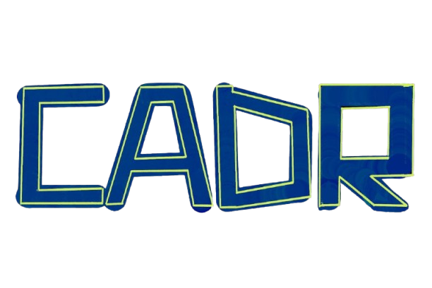
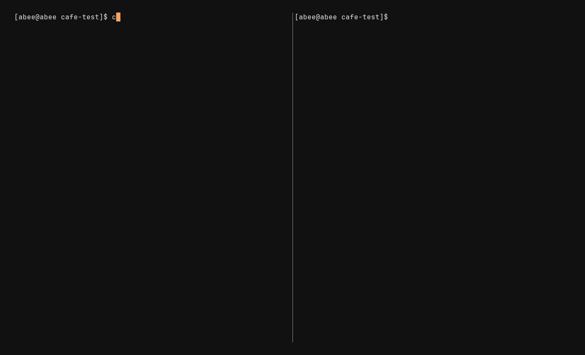
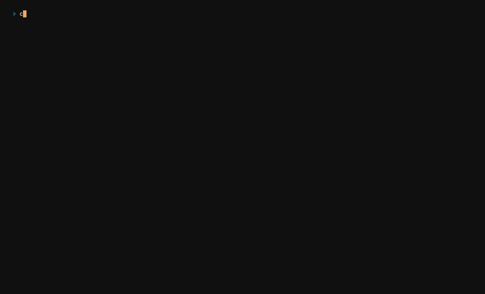

<p align="center">
  
</p>

<p align="center">
  <b>The cadastre for your codebase.</b><br>
  <i>100% local. Real-time. No cloud.</i>
</p>

<p align="center">
  
  
  
</p>

<hr />

<p align="center">
  
</p>

cadr displays a real-time map of your codebase's execution flow directly in the terminal. Explore complex architectures, follow execution paths during runtime, evaluate caller/callee dependencies, and execute API requests without manual logging or cloud APM agents.

---

## Table of Contents

- [Overview](#overview)
- [Installation](#installation)
- [Quick Start](#quick-start)
- [Command Cheat Sheet](#command-cheat-sheet)
- [TUI Controls & Navigation](#tui-controls--navigation)
- [Language Support](#language-support)
- [cadr api (API Explorer)](#cadr-api-api-explorer)
- [cadr MCP Server (AI Agents)](#cadr-mcp-server-ai-agents)
- [Known Limitations](#known-limitations)
- [Documentation](#documentation)
- [Contributing](#contributing)
- [License](#license)

---

## Overview

cadr combines three systems into one terminal workspace:

1. **Static Analysis Engine (Tree-sitter):** Parses your codebase into an in-memory directed graph of files, directories, functions, and endpoints. Resolves callers and callees without having to compile.
2. **Dynamic Tracing Engine:** Injects zero-dependency runtime probes into the codebase, capturing function entries and exits along with their durations over local IPC (UDS) sockets.
    *(Python/Go: entries, exits, durations; JavaScript: entries only)*
3. **Interactive TUI:** A dual-pane terminal interface that maps live runtime events onto the static codebase tree, rendering traffic heatmaps, chronological function calls, and dependency trees.

Failures are surfaced in place: a crash (panic, uncaught Python exception, or a panic recovered by `net/http`) is captured from the run's stderr, attributed to the function that owns the failing source line, and marked with a red `✗` in both panes — the row that failed and the function that is currently broken. The `cadr trace` subcommands report the same errors (`cadr trace summary`, `trace verify`) and the MCP trace tools include an `errors:` section and a `structuredContent` envelope.

---

## Installation

### Pre-built Binary (Linux / macOS)
Download the latest pre-compiled binary for your architecture from [GitHub Releases](https://github.com/abhinavdevarakonda/cadr/releases).

### Go Install
```bash
go install github.com/abhinavdevarakonda/cadr/cmd/cadr@latest
```

<details>
<summary><b>Build from Source (Linux / macOS)</b></summary>

Requires Go 1.22+ and a C compiler (`gcc` or `clang`) for Tree-sitter CGO bindings:

```bash
git clone https://github.com/abhinavdevarakonda/cadr.git
cd cadr
go build -o cadr ./cmd/cadr
sudo mv cadr /usr/local/bin/
```
</details>

<details>
<summary><b>Windows Setup</b></summary>

**WSL (Recommended):**
Follow the Linux installation steps inside your WSL terminal.

**Native PowerShell:**
1. Install a C compiler (e.g., `scoop install gcc` or `choco install mingw`).
2. Run `go install github.com/abhinavdevarakonda/cadr/cmd/cadr@latest`.
3. For the cleanest rendering, run cadr inside *Windows Terminal*.
</details>

---

## Quick Start

### 1. Launch the Live TUI
In your repository root:
```bash
cadr . 
```
The left pane renders your codebase structure. The right pane listens for incoming trace events, as well as some static information like callers and callees.

### 2. Run and Trace an Application
In a separate terminal (or background process):
```bash
cadr run "python app.py"
# or
cadr run "go run ."
# or
cadr run "node server.js"
```
cadr injects runtime environment hooks, executes the target command, and streams function call events directly to the active TUI.

### 3. Record Traces for Offline Inspection
```bash
cadr rec "pytest"
# or
cadr rec "go test ./..."
```
Runs the command and saves structured trace events to `.cadr/traces/` for querying via `cadr trace` or MCP tools.

---

## Command Cheat Sheet

```text
cadr .                  Start the live TUI dashboard in the current directory
cadr run "<cmd>"        Execute and live-stream traces to the cadr TUI
cadr rec "<cmd>"        Execute and record trace session to .cadr/traces/
cadr api                Launch the terminal API Explorer
cadr mcp                Start the Model Context Protocol (MCP) server over stdio
cadr trace list         List all recorded trace runs
cadr trace summary      Display function execution metrics (count, total, self time)
cadr trace tree         Print the call tree (--ctx <id>, --fn <name>); unscoped lists contexts
cadr trace diff         Compare execution differences between two runs
cadr trace verify       validate a run's internal stream invariants (--graph also joins against the static graph).
cadr trace clear        Delete recorded trace runs
cadr serve .            Start the local web graph visualizer (localhost:6433)
```

---

## TUI Controls & Navigation

cadr uses standard Vim keybindings for navigation (`j/k` up and down, `h/l` expand and collapse, `/` fuzzy search).

Core controls:
- `Tab` / `t`: Cycle right pane between **Flow** (chronological events), **Impact** (callers), and **Trace** (callees).
- `Space`: Pause or resume real-time trace streaming.
- `f`: Toggle Follow Live (keeps the tree focused on active functions or lets you browse freely).
- `Enter`: Open the selected file, directory, or function directly in your `$EDITOR` at that exact line.
- `H` / `L`: Scrub backward and forward through the execution history.
- `c`: Collapse all folders to the root. Press again to restore previous expansion state.
- `a`: Acknowledge file changes in the diff view.

<details>
<summary><b>Complete Keybindings Table</b></summary>

| Key | Context | Action |
| :--- | :--- | :--- |
| `j` / `k` | Tree / Lists | Move selection down / up |
| `h` / `l` | Left Pane | Collapse folder / expand folder |
| `i` | Global | Switch focus between Left (Structure) and Right (Inspection) panes |
| `Enter` | Selection | Open file or function in `$EDITOR` at declaration line |
| `Tab` / `t` | Right Pane | Cycle view: Flow -> Impact -> Trace |
| `Space` | Global | Pause / unpause live trace stream |
| `f` | Global | Toggle auto-follow for active execution nodes |
| `c` | Left Pane | Toggle collapse all / restore folder expansion |
| `H` / `L` | Right Pane | Step backward / forward through execution playhead |
| `a` | Diffs | Acknowledge selected file diff |
| `A` | Diffs | Acknowledge all file diffs |
| `/` | Global | Fuzzy search symbols and files |
| `q` / `Ctrl+c` | Global | Exit cadr |

</details>

---

## Language Support

- **Python**
  - Static Graph: Definitions, calls, classes, and decorators.
  - Dynamic Tracing: Function entry and exit, execution durations, formal argument capture via `sys.settrace`.
  - Frameworks: FastAPI and Flask route and parameter extraction.
- **Go**
  - Static Graph: Functions, struct methods, interfaces, and cross-package calls.
  - Dynamic Tracing: Process-wide tracking via `-overlay` / `-toolexec` compiler toolchain interception.
  - Frameworks: Gin (`gin-gonic/gin`) route groups, parameters, and handler mapping.
- **JavaScript / TypeScript**
  - Static Graph: Function declarations, arrow functions, class methods.
  - Dynamic Tracing: entry-only call events via NODE_OPTIONS (regex source instrumentation; no durations/call tree yet).
- **C / C++**
  - Static Graph: Functions, declarations, and call references.
  - Dynamic Tracing: In roadmap (`-finstrument-functions`).

---

## cadr api (API Explorer)

<p align="center">
  
</p>

`cadr api` provides a terminal-native API client that inspects your codebase to discover routes, maps underlying handler functions, and executes HTTP requests.

Launch with:
```bash
cadr api
```

Key features:
- **Automatic Route Discovery:** Statically scans Gin, FastAPI, and Flask routes without running the server.
- **Path and Query Parameter Handling:** Automatically substitutes path parameters (`:id`, `{user_id}`, `<int:id>`) from inputs.
- **Persistent Input Caching:** Headers, parameters, and request body payloads are saved per-endpoint in `.cadr/cache/api_cache.json`.
- **Side-by-Side Call Graph:** Inspect the exact backend function call tree alongside the raw HTTP response.
- **Send and Copy:** `Ctrl+s` sends the request. `y` copies the response payload to your system clipboard.

For full details, see the [API Explorer Guide](docs/api-explorer.md).

---

## cadr MCP Server (AI Agents)

cadr runs as a Model Context Protocol (MCP) server, giving AI coding assistants (Claude Desktop, Cursor, Antigravity, Windsurf) direct access to static graph queries and dynamic execution traces.

Add cadr to your client configuration (e.g. `claude_desktop_config.json`):

```json
{
  "mcpServers": {
    "cadr": {
      "command": "cadr",
      "args": ["mcp"]
    }
  }
}
```

Core tools exposed to AI agents:
- `find_symbol`: Resolve functions and methods into qualified graph identifiers.
- `impact_analysis`: Calculate transitive blast radius (all callers affected by a change).
- `trace_calls`: Map the complete downstream call tree of a function.
- `get_node_source`: Read exact function source boundaries without reading entire files.
- `get_last_trace`: Read the most recent recorded run. Record runs with `cadr rec "<command>"`.

For the full 16-tool reference and agent prompts, see the [MCP Server Guide](docs/mcp.md).

---

## Known Limitations

- **JavaScript coverage**: regex-based CJS instrumentation; ESM, eval/new Function, and expression-body arrows
   are not traced; no exit events/durations.
- **Go Standalone Binaries:** `cadr run` instruments execution verbs (`go run`, `go test`). Standalone `go build` invocations are deliberately uninstrumented so production release binaries remain untouched.
- **Error attribution:** only failures that `cadr` can see on stderr are recorded — uncaught panics/exceptions and panics recovered by `net/http`. An application that handles an error and keeps running leaves no crash record; the raw stderr tail is still kept in `.cadr/traces/runs/<id>.stderr.log`. Frames outside the project, or at module level, are not attributed to a function.
- **Docker and Remote Containers:** When running target applications inside containers or remote environments, specify `--tcp` mode instead of Unix Domain Sockets so the tracer can route events over network interfaces.

---

## Documentation

- [CLI Trace Reference](docs/trace-cli.md) — Subcommands, queries, diffing, and JSON schemas.
- [MCP Server Guide](docs/mcp.md) — AI agent configuration, tool definitions, and prompts.
- [API Explorer Guide](docs/api-explorer.md) — Framework route extraction, parameters, and controls.
- [Contributing Guide](CONTRIBUTING.md) — Architecture, subsystem responsibilities, and extension recipes.

---

## Contributing

Contributions are welcome. Please read [CONTRIBUTING.md](CONTRIBUTING.md) for details on codebase structure, development setup, and pull request guidelines.

---

## License

MIT License. See [LICENSE](LICENSE) for details.
